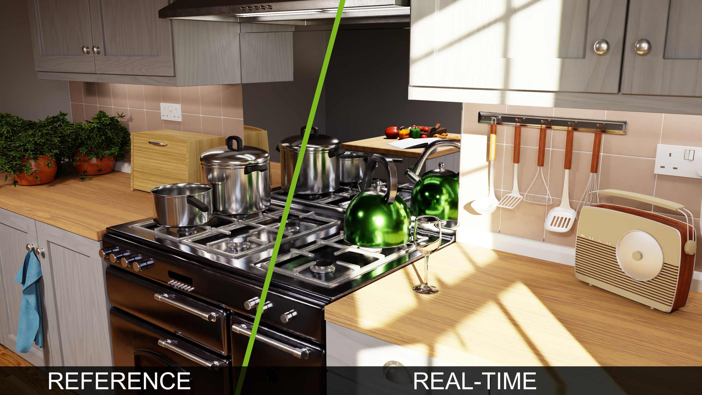
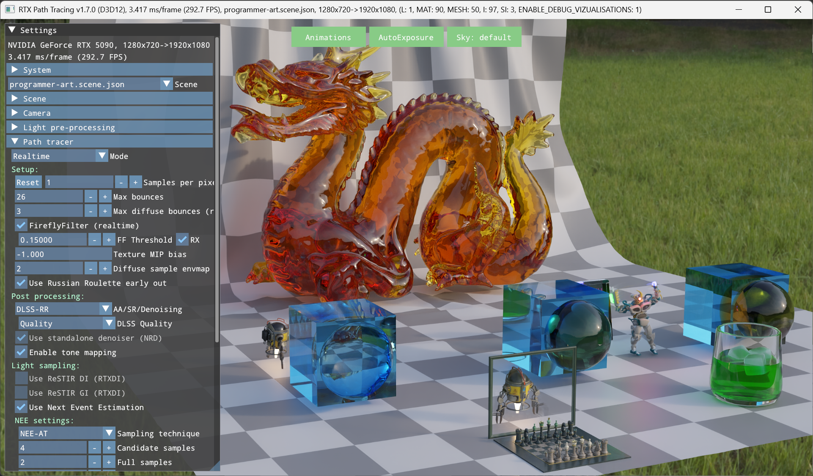

# RTX Path Tracing v1.9.0



## What's new in 1.9.0

 * Performance optimizations (~20% perf gain over 1.8.1 with comparable or better quality), including optional sub-sampling (sub-1spp), async compute overlap of DLSS-RR with the next frame's path tracing, GPU-side TLAS instance generation and large CPU-side savings
 * New [Design](Docs/Design.md) document describing the real-time path tracing pipeline
 * SHaRC radiance cache is now part of the real-time path tracer and on by default, bringing more indirect lighting into DLSS-RR at about the same cost
 * NEE-AT now handles up to 2 million lights (was 512K), and clusters emissive triangles into light LODs for scenes with dense emissive geometry
 * Windows on ARM64 is now supported (see [Windows ARM64](#windows-arm64))
 * Updated Streamline (2.14.16), NRD (4.17.3), RTXDI (3.0), OMM (1.10) and DirectX Agility SDK (1.619.6); CMake 4.1 is now required
 * Various code fixes, optimizations and improvements
 
See [Releases](https://github.com/NVIDIA-RTX/RTXPT/releases) for more detail and downloads.

## Overview

RTX Path Tracing is a code sample that strives to embody years of ray tracing and neural graphics research and experience. It is intended as a starting point for a clean path tracer integration, as a reference for various integrated SDKs, and/or for learning and experimentation. 

It is a pure path tracer that does not rely on rasterization. In its main configuration, all light transport is evaluated by a single, unified path tracing shader, leveraging light-sampling and radiance caches for real-time performance. It further employs path-space layer decomposition and guide-buffer generation to support real-time denoising (DLSS-RR) and other techniques.

The base path tracing implementation derives from NVIDIA’s [Falcor Research Path Tracer](https://github.com/NVIDIAGameWorks/Falcor), ported to the approachable C++/HLSL [Donut framework](https://github.com/NVIDIA-RTX/Donut). 

See the [RTXPT Design documentation](Docs/Design.md) for more information on the architecture.


## Features

* DirectX 12 and Vulkan back-ends
* Reference and real-time modes
* Simple BSDF model that is easy(ish) to extend
* Simple asset pipeline based on glTF 2.0 (support for a subset of glTF extensions including animation)
* Volumes and nested dielectrics with priority
* Support for analytic lights (directional, spot, point), emissive triangles and environment map lighting
* NEE lighting with feedback-based, temporally adaptive guided importance sampling (NEE-AT)
* Path tracing features such as: Low-discrepancy sample generator based on [Practical Hash-based Owen Scrambling](https://jcgt.org/published/0009/04/01/paper.pdf), use of [RayCones](https://research.nvidia.com/publication/2021-04_improved-shader-and-texture-level-detail-using-ray-cones) for texture MIP selection, Russian roulette early path termination, firefly filter and similar 
* Basic post-processing features such as: TAA, tone mapping, bloom and similar
* Reference mode 'photo-mode screenshot' with simple [OptiX denoiser](https://developer.nvidia.com/optix-denoiser) integration
* [Shader Execution Reordering](https://developer.nvidia.com/blog/improve-shader-performance-and-in-game-frame-rates-with-shader-execution-reordering/) for significant increase in execution performance
* [RTXDI](https://github.com/NVIDIA-RTX/RTXDI) integration for ReSTIR DI (light importance sampling) and ReSTIR GI (indirect lighting)
* [SHaRC](https://github.com/NVIDIA-RTX/SHARC) integration for spatially hashed radiance caching
* [OMM](https://github.com/NVIDIA-RTX/OMM) integration for fast ray traced alpha testing
* [NRD](https://github.com/NVIDIA-RTX/NRD) ReLAX and ReBLUR denoiser integration with up to 3-layer path space decomposition
* [RTXTF](https://github.com/NVIDIA-RTX/RTXTF) integration for Stochastic Texture Filtering (disabled by default; enable with `RTXPT_STOCHASTIC_TEXTURE_FILTERING_ENABLE` in `Rtxpt/Shaders/PathTracer/Config.h`)
* [Streamline](https://github.com/NVIDIA-RTX/Streamline) integration for DLSS (DLSS-RR, DLSS-SR, DLAA, DLSS-FG & MFG) and Reflex


## Intro Sample

The repository also includes the **Intro Sample** (`IntroSample`), a second executable with an entirely different rendering architecture from the main sample. The two share only the framework: scene and material loading, acceleration structures, environment map baking, DLSS integration and post-processing.

The main sample is a unified path tracer: a single path tracing shader computes all light transport for a pixel and decomposes it into denoising layers for DLSS-RR. The Intro Sample demonstrates an incremental route from a conventional deferred renderer to a simplified real-time path tracer, showing how an existing raster engine can adopt ray-traced lighting one component at a time.

Its steps, selectable at runtime, begin with a typical deferred renderer architecture, with image-based lighting, screen-space ambient occlusion and screen-space reflections. Each step introduces a technique and can be compared directly against the previous one in the same scene. Early steps replace individual lighting components with ray traced variants; later steps unify indirect diffuse, specular reflection and refraction in a single path-tracing pass. The final renderer combines this with resampled direct lighting, multi-bounce indirect illumination, and DLSS-RR reconstruction. It retains the G-buffer and separate direct-lighting stage of its deferred foundation, providing a concrete example of how a hybrid architecture can evolve into a path tracer. It is not a simplified version of the main sample’s path tracer.


## Requirements

- Windows 10 20H1 (version 2004-10.0.19041) or newer
- DXR Capable GPU (DirectX Raytracing 1.1 API or higher) with Shader Model 6.6 and Resource Binding Tier 3 on DirectX 12, or `VK_EXT_mutable_descriptor_type` on Vulkan; if DXR 1.2 is not available, disable the Agility SDK (see [Known Issues](#known-issues))
- GeForce Game Ready Driver 595.71 or newer
- DirectX 12 or Vulkan API
- CMake v4.1+; the first configure downloads dependencies (DXC, Agility SDK, Streamline and others), so it needs internet access
- Visual Studio 2022 (v143 build tools) or later with Windows SDK version 10.0.20348.0 or 10.0.26100.0 or later


## Known Issues

* By default, Agility SDK 1.619 is enabled and requires DXR 1.2 (Shader Model 6.9). Our current setup can only switch to older shader models at build configuration time, so if your GPU does not support DXR 1.2 with Shader Model 6.9, set the `RTXPT_D3D_AGILITY_SDK_VERSION_NAME` CMake variable to empty (`RTXPT_D3D_AGILITY_SDK_PATH` and `RTXPT_D3D_AGILITY_SDK_VERSION` follow it), clean the `/bin` folder, then re-configure and rebuild the project.
* Enabling Vulkan support requires a couple of manual steps, see [below](#building-vulkan)
* SER and OMM support on Vulkan is currently work in progress
* Running Vulkan on AMD GPUs may trigger a TDR during TLAS building in scenes with null TLAS instances
* Enabling debug layer on Vulkan will show a number of warnings and errors - fixes are work in progress
* We recommend using *NVIDIA Nsight Graphics* for frame capture and analysis. If using other GPU performance tuning and debugging tools such as *PIX on Windows*, it is advisable to disable NVRHI_WITH_NVAPI and DONUT_WITH_STREAMLINE variables in CMake to avoid compatibility issues. Please note: disabling these settings results in lower performance and missing features
* There is a known issue resulting in LIVE_DEVICE DirectX warnings reported at shutdown when Streamline is enabled in Debug builds
* There is a known issue resulting in black or incorrect transparencies/reflection on some AMD systems with latest drivers; this is most likely a driver error and has been reported


## Folder Structure

|						| |  
| -						| - |
| /bin                       | default CMake folder for binaries and compiled shaders (ARM64 builds use /bin_arm64)
| /build                     | default CMake folder for build files
| /Assets                    | models, textures, scene files  
| /Docs                      | documentation 
| /External                  | external libraries and SDKs, including Donut, Streamline, NRD, RTXDI, and OMM
| /Support                   | optional tools (ImageMagick, test scripts; CMake downloads the OptiX denoiser here)
| /Testing                   | unit tests, image regression testing and capture sequence scripts
| /Rtxpt                     | **RTX Path Tracing core; AdvancedSample.cpp is the entry point, Sample.cpp/.h the application base, Shaders/PathTracerSample.hlsl the main raygen shader**
| /Rtxpt/Shaders/PathTracer  | **Core path tracing shaders**
| /Rtxpt/IntroSample         | [Intro Sample](Docs/intro-sample.md) host code
| /Rtxpt/Shaders/IntroSample | [Intro Sample](Docs/intro-sample.md) shaders


## Build

At the moment, only Windows builds are fully supported. We are going to add Linux support in the future.

1. Clone the repository **with all submodules recursively**:
   
   `git clone --recursive https://github.com/NVIDIA-RTX/RTXPT.git`

2. Use CMake to configure the build and generate the project files.
   
   ```
   cd RTXPT
   cmake CMakeLists.txt -B ./build
   ```

   Use `-G "<generator>"` if a specific Visual Studio (or other) generator is required. This builds for the build machine's architecture; for Windows on ARM see [Windows ARM64](#windows-arm64) below. 

3. Build the solution generated by CMake in the `./build/` folder.

   For example, if using Visual Studio, open the generated solution `build/RTXPathTracing.sln` and build it.

4. Select and run the `Rtxpt` project. Binaries get built to the `bin` folder. Assets/media are loaded from `Assets` folder.

   The solution builds two executables: `Rtxpt` (the full sample described in this README) and `IntroSample` (a separate hybrid ray tracing sample, see [Intro Sample](Docs/intro-sample.md)). Both share the same framework, scenes and command line options.

   If making a binary build, the `Assets` and `Support` folders can be placed into `bin` next to executable and packed up together (i.e. the sample app will search for both `Assets/` and `../Assets/`).

### Windows ARM64

Pass `-A ARM64` to cross-build for Windows on ARM from an x64 machine; on an ARM64 machine it is the default. Cross-building requires a Visual Studio generator and the MSVC C++ ARM64/ARM64EC build tools component for your toolset (for VS 2022: "MSVC v143 - VS 2022 C++ ARM64/ARM64EC build tools"). ARM64EC is not supported.

```
cmake -S . -B build-arm64 -A ARM64
cmake --build build-arm64 --config Release
```

ARM64 binaries are written to `bin_arm64` (x64 builds keep using `bin`). To run on another machine, copy `bin_arm64` and `Assets` (plus `Support` if needed) as sibling folders and launch `bin_arm64/Rtxpt.exe`. The Streamline DLLs need the ARM64 Visual C++ 2015-2022 Redistributable (`vc_redist.arm64.exe`) on that machine.


## Building Vulkan

Vulkan support is not enabled by default. To enable it:
 * Set the DONUT_WITH_VULKAN CMake variable to ON (NVRHI_WITH_VULKAN follows it) and re-configure. No Vulkan SDK is needed to build: SPIR-V shaders are compiled with the same embedded DXC (`External/dxc`) as DXIL, and the Vulkan headers are fetched at configure time
 * Leave DXC_SPIRV_PATH at its default (the embedded DXC) so that precompiled and runtime-compiled SPIR-V shaders use the same compiler; reset it if an older configure pointed it at the Vulkan SDK
 * Install the Vulkan SDK only if you need the validation layers enabled by `--debug`
 * To run with Vulkan use `--vk` command line parameter
 

## DirectX 12 Agility SDK
RTX Path Tracing integrates the [DirectX 12 Agility SDK](https://devblogs.microsoft.com/directx/directx12agility/) and enables it by default: CMake downloads the version set in the `RTXPT_D3D_AGILITY_SDK_VERSION_NAME` CMake variable (default `1.619.6`; `1.717.0-preview` and `1.719.0-preview` are also offered) from NuGet into `External/AgilitySDK/<version>`. `RTXPT_D3D_AGILITY_SDK_PATH` and `RTXPT_D3D_AGILITY_SDK_VERSION` are derived from it on every configure, so to change the version set `RTXPT_D3D_AGILITY_SDK_VERSION_NAME`; set it to empty to build without the Agility SDK (see [Known Issues](#known-issues)).

Agility SDK 1.619 and newer enables native DirectX support for [Shader Execution Reordering](https://devblogs.microsoft.com/directx/ser/) and [Opacity Micromaps](https://devblogs.microsoft.com/directx/omm/) (DXR 1.2, Shader Model 6.9). On NVIDIA hardware this needs a driver with DXR 1.2 support (see [Requirements](#requirements)).


 ## User Interface

Once the application is running, most of the SDK features can be accessed via the UI window on the left hand side and drop-down controls in the top-center. 



Camera can be moved using W/S/A/D keys and rotated by dragging with the left mouse button.


## Command Line

- `--scene` loads a specific .scene.json file; example: `--scene programmer-art.scene.json`
- `--width` and `--height` to set the window size; example: `--width 3840 --height 2160`
- `--fullscreen` to start in full screen mode; example: `--width 3840 --height 2160 --fullscreen`
- `--debug` to enable the graphics API debug layer or runtime, and additional validation layers.
- `--gpuValidation` to enable D3D12 GPU-based validation and the debug layers in Debug or Release builds. This can significantly slow startup and rendering; it disables Aftermath when enabled.
- `--vk` to enable Vulkan (see [building-vulkan](#building-vulkan))
- `--adapter <name>` or `--adapterIndex <n>` to select the GPU; example: `--adapter RTX`
- `--noSER` to disable Shader Execution Reordering
- `--nonInteractive` to disable popups and windows that require input (for scripted runs)
- `--captureSimple` to capture a screenshot after a default warm-up; use `--capturePath` to specify the output file

See `Rtxpt/SampleCommon/CommandLine.cpp` for the full list of options.
 

## Contact

RTX Path Tracing is under active development. Please report any issues directly through GitHub issue tracker, and for any information, suggestions or general requests please feel free to contact us at pathtracing-sdk-support@nvidia.com!

## Thanks

Many thanks to the developers of the following open-source libraries or projects that make this project possible:
 * dear imgui (https://github.com/ocornut/imgui)
 * DirectX Shader Compiler (https://github.com/microsoft/DirectXShaderCompiler)
 * cgltf, Single-file glTF 2.0 loader (https://github.com/jkuhlmann/cgltf)
 * Krzysztof Narkowicz's Real-time BC6H compression on GPU (https://github.com/knarkowicz/GPURealTimeBC6H)
 * okdshin's https://github.com/okdshin/PicoSHA2
 * cxxopts (https://github.com/jarro2783/cxxopts)
 * Tracy Profiler (https://github.com/wolfpld/tracy)
 * ImageMagick (https://imagemagick.org)
 * Declan Russell's OptiX denoiser command line tool (https://github.com/DeclanRussell/NvidiaAIDenoiser)
 * ...and any we might have forgotten (please let us know) :)

## Citation
If you use RTX Path Tracing in a research project leading to a publication, please cite the project.
The BibTex entry is

```bibtex
@online{RTXPT,
   title   = {{{NVIDIA}}\textregistered{} {RTX Path Tracing}},
   author  = {{NVIDIA}},
   year    = 2023,
   url     = {https://github.com/NVIDIA-RTX/RTXPT},
   urldate = {2024-01-26},
}
```

## License

See [LICENSE.txt](LICENSE.txt)

This project includes NVAPI software. All uses of NVAPI software are governed by the license terms specified here: https://github.com/NVIDIA/nvapi/blob/main/License.txt.
